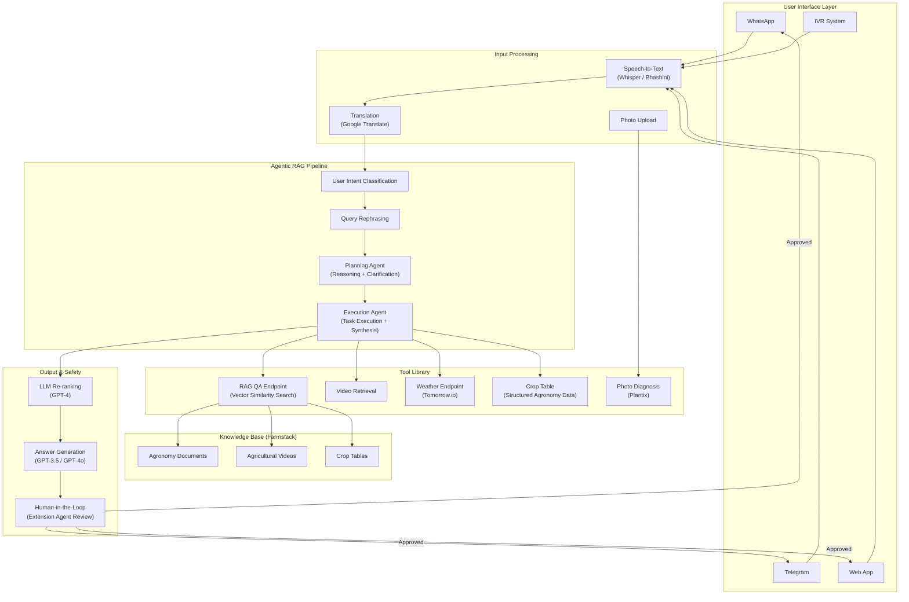
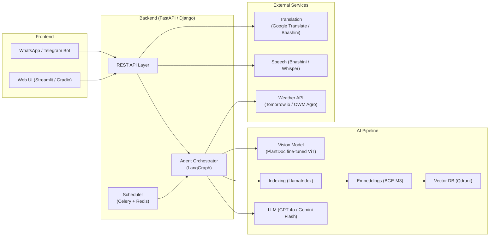
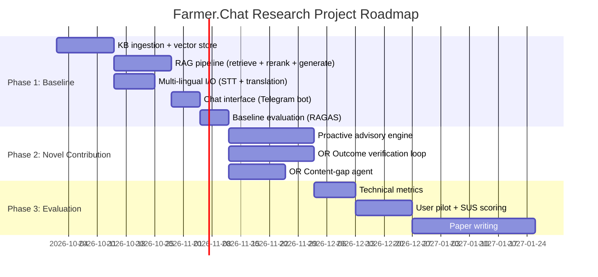

# Farmer.Chat — Comprehensive Research Report

## 1. What Farmer.Chat IS (The Existing System)

Farmer.Chat is an **AI-powered, multi-modal, multi-lingual agricultural advisory chatbot** created by **Digital Green** (in collaboration with Gooey.AI and Microsoft Research India). It serves smallholder farmers and extension agents across **India, Kenya, Ethiopia, and Nigeria**.

### Core Architecture (What's Already Built)

### What Components Exist Today

| Component | Status | Details |
|-----------|--------|---------|
| **RAG Pipeline** | ✅ Deployed | Vector similarity search over Farmstack KB, LLM re-ranking, answer generation |
| **Multi-platform delivery** | ✅ Deployed | WhatsApp, Telegram, Web, Mobile, IVR |
| **Multi-lingual support** | ✅ Deployed | Voice + text in Hindi, Swahili, Amharic, etc. via Whisper/Bhashini/Google Translate |
| **Photo-based diagnosis** | ✅ Deployed | Users upload crop photos for disease identification |
| **Human-in-the-loop review** | ✅ Deployed | Extension agents verify high-risk advice (pesticides, dosages) |
| **Planning + Execution agents** | ✅ Described in paper | Multi-agent workflow with reasoning/execution separation |
| **Weather integration** | ✅ Deployed | Tomorrow.io for real-time + forecast data |
| **Proactive advisories** | ⚠️ Partially described | Crop-calendar-aware push alerts — described but not deeply documented |
| **Outcome verification** | ❌ Not implemented | Follow-up photo verification loop is a novelty idea, not in production |
| **Content-gap agent** | ❌ Not implemented | Turning unanswered queries into draft KB entries is a novelty idea |
| **Backend** | ✅ Deployed | Django REST Framework APIs |
| **Prompt library** | ✅ Open-sourced | [farmerchat-prompts](https://github.com/digitalgreenorg/farmerchat-prompts) on GitHub |
| **Full codebase** | ❌ Not verified open | Repo `Farmer.Chat` exists under `digitalgreenorg` but full openness unverified |

### Reported Performance Metrics (from the arXiv paper)

| Metric | Value |
|--------|-------|
| Answered rate | ~75% of queries |
| Unanswered due to content gaps | ~66% of unanswered queries |
| Average latency | ~8-9 seconds |
| RAGAS faithfulness | 0.77–0.87 |
| Context precision | ~71% |

---

## 2. What YOU Need to Build

Based on the project description, you are building a **research prototype** that replicates the baseline system and then adds novel improvements. Here's the breakdown:

### Phase 1: Baseline Replica (The "Reactive RAG Pipeline")

This is your **control/baseline** system — a functional replica of the core Farmer.Chat:

| Component | What to Build |
|-----------|---------------|
| **Knowledge Base** | Ingest agricultural documents (PDFs, video transcripts, crop tables) into a vector store |
| **RAG Pipeline** | Query → Rephrase → Retrieve → Re-rank → Generate answer |
| **Intent Classification** | Classify queries as in-scope / out-of-scope / unclear |
| **Multi-lingual I/O** | Text translation + speech-to-text for at least 2 languages |
| **Photo Diagnosis** | Image upload → disease classification → treatment recommendation |
| **Chat Interface** | WhatsApp/Telegram bot OR web UI |
| **Safety Guardrails** | Source-only answers; flag chemical/dosage advice for expert review |
| **Evaluation** | RAGAS metrics (faithfulness, context precision, answer relevance), latency, answered rate |

### Phase 2: Novel Contributions (Where Your Research Value Lives)

These are the **three novelty options** described in your project brief — pick one or more:

#### Novelty A: Weather- & Calendar-Triggered Proactive Advisories
> **Goal:** The system *pushes* advice to farmers based on crop calendars and weather forecasts, rather than waiting for them to ask.

- Build a crop calendar engine (planting, fertilizing, harvesting schedules per crop per region)
- Integrate weather API for forecast-driven triggers (e.g., "heavy rain in 2 days → don't spray pesticides")
- Push notifications via WhatsApp/Telegram
- **Measure:** Acted-on advice rate vs. reactive baseline

#### Novelty B: Closed-Loop Outcome Verification
> **Goal:** After giving advice (e.g., "this looks like leaf blight, apply X"), schedule a follow-up check where the farmer sends a new photo, and the system verifies whether the condition improved.

- Implement a follow-up scheduling engine (remind farmer after N days)
- Compare before/after photos using vision model
- Detect misdiagnosis and escalate to human expert
- **Measure:** Misdiagnosis catch rate, escalation precision/recall

#### Novelty C: Content-Gap Agent
> **Goal:** When the system can't answer a query (the 25% failure rate), automatically draft a KB entry from the query and route it to an expert for approval.

- Detect "out-of-content" queries
- Use LLM to draft a structured KB entry from the query + web search
- Queue for expert review → approved entries get added to KB
- **Measure:** Reduction in unanswered rate on held-out query set

---

## 3. What Can Be Improved Over the Existing System

### Known Limitations (from the papers) → Your Improvement Opportunities

| Limitation | Improvement Strategy |
|------------|---------------------|
| **25% unanswered rate** (66% due to content gaps) | Content-Gap Agent (Novelty C) — auto-populate KB from failed queries |
| **Translation struggles with local dialects** | Use Bhashini (Indian) + fine-tuned Whisper for low-resource languages; LoRA fine-tuning on dialect data |
| **~9s average latency** | Use Gemini 1.5 Flash or fine-tuned smaller models (Llama 3 8B) for low-latency generation; cache frequent queries |
| **71% context precision** | Better chunking strategies (sentence-window retrieval in LlamaIndex), hybrid search (dense + sparse via BGE-M3), improved re-ranking |
| **Low-literacy users can't phrase queries** | Guided conversation flows with suggested prompts; voice-first UX with proactive push (Novelty A) |
| **No offline mode** | Pre-cache common advisories; SMS fallback for areas with poor internet |
| **Gender-based-violence gap in red-teaming** | Add safety classifiers for sensitive topics; route to appropriate helplines |
| **Reactive-only design** | Proactive advisories (Novelty A) — the biggest architectural gap |
| **No feedback loop** | Outcome verification (Novelty B) — closes the advisory loop |
| **Generic LLM tone** | SFT with LoRA on "golden facts" (per the 2026 paper's hybrid architecture) for culturally appropriate delivery |

### Insights from the 2026 Follow-Up Paper (arXiv:2603.03294)

> [!IMPORTANT]
> This paper introduces techniques you should consider before claiming novelty:

- **DG-EVAL Framework**: A new automated evaluation doing atomic fact verification against expert ground truth (not Wikipedia). More rigorous than standard RAGAS.
- **LoRA Fine-Tuning on Golden Facts**: Smaller models fine-tuned on expert-curated atomic facts outperform larger frontier models on factual accuracy.
- **Stitching Layer**: Separates factual retrieval from conversational delivery — verified facts get wrapped in culturally appropriate language.
- **evaluate.farmer.chat**: A web platform for human expert evaluation (Likert scales + pairwise comparison).
- **Released Dataset**: `DigiGreen/human_curated_qa_dataset` for benchmarking.

> [!TIP]
> Your novelty should be **orthogonal** to these contributions. The proactive advisory system (Novelty A) and outcome verification loop (Novelty B) are NOT covered by this paper — they remain genuinely novel.

---

## 4. Recommended Tech Stack

### Architecture Overview

### Component-by-Component Recommendations

| Layer | Recommended | Why |
|-------|-------------|-----|
| **RAG Framework** | **LlamaIndex** | Purpose-built for data ingestion/retrieval; out-of-the-box sentence-window retrieval, hierarchical routing |
| **Agent Orchestration** | **LangGraph** | Stateful, controllable multi-agent graphs — critical for safety guardrails in agricultural advice |
| **Vector Database** | **Qdrant** (self-hosted) or **ChromaDB** (prototyping) | Qdrant: performant, open-source, free self-hosted. ChromaDB: easiest for rapid prototyping |
| **Embeddings** | **BGE-M3** | Multilingual (100+ languages), supports dense+sparse+multi-vector retrieval |
| **Primary LLM** | **GPT-4o** (accuracy) / **Gemini 1.5 Flash** (cost/speed) | GPT-4o for high-stakes answers; Gemini Flash for volume queries and low latency |
| **Open-Weight LLM** | **Llama 3 8B** (+ LoRA fine-tuning) | Cost-effective for deployment; fine-tune on agricultural golden facts per the 2026 paper |
| **Speech-to-Text** | **Bhashini** (India) / **Google Cloud STT Chirp** (Africa) | Bhashini handles rural Indian dialects; Chirp handles Swahili/Amharic |
| **Translation** | **Bhashini** (India) / **Google Translate** (general) | Best available for low-resource language pairs |
| **Image Diagnosis** | **PlantVillage/PlantDoc** fine-tuned ViT (own) or **Plantix API** (fast) | Build custom model for research contribution; use Plantix API for quick deployment |
| **Weather API** | **Tomorrow.io** (precision) / **OpenWeatherMap Agro** (cost) | Tomorrow.io for real-time alerts; OWM Agro for vegetation indices (NDVI) |
| **Messaging** | **WhatsApp Business API** (primary) + **Telegram Bot API** (dev/testing) | WhatsApp has near-ubiquitous farmer adoption |
| **Backend** | **FastAPI** (new build) or **Django REST Framework** (to match original) | FastAPI for performance; DRF if you want closer parity with original |
| **Task Scheduling** | **Celery + Redis** | For proactive advisory scheduling, follow-up reminders |
| **Evaluation** | **RAGAS** + **DG-EVAL** + **SUS** | RAGAS for RAG metrics; DG-EVAL for agriculture-specific fact verification; SUS for usability |
| **Database** | **PostgreSQL** | User profiles, crop calendars, conversation history |

---

## 5. Current State of the Field (What You Must Know)

### The Kenya RCT (Registered July 2026)
- **600 villages** in Nakuru County, Kenya
- Measuring impact on **knowledge, practice adoption, crop yields, and household income**
- This proves Farmer.Chat has moved past proof-of-concept into **rigorous field evaluation**
- Your work complements this by focusing on **technical improvements** rather than impact measurement

### Key Open-Source Resources Available

| Resource | Link | Use |
|----------|------|-----|
| farmerchat-prompts | [GitHub](https://github.com/digitalgreenorg/farmerchat-prompts) | System prompts for conversation states (rephrase, rerank, exit, out-of-context) |
| DigiGreen/human_curated_qa_dataset | HuggingFace (from 2026 paper) | Benchmark your system against expert-curated Q&A pairs |
| PlantDoc | [GitHub](https://github.com/pratikkayal/PlantDoc-Dataset) | 2,500+ images of 13 plant species for disease detection training |
| PlantVillage | [Kaggle](https://www.kaggle.com/datasets/abdallahalidev/plantvillage-dataset) | 54k+ images for plant disease classification |
| RAGAS | [GitHub](https://github.com/explodinggradients/ragas) | RAG evaluation framework |
| evaluate.farmer.chat | Web platform (from 2026 paper) | Human evaluation with Likert + pairwise comparison |

### Existing Prompt Architecture (from `farmerchat-prompts`)

The open-sourced prompts reveal the system's conversation state machine:

| Prompt | Purpose |
|--------|---------|
| `CONVERSATION_PROMPT` | Main advisory conversation flow |
| `UNCLEAR_QN_PROMPT` | Seeks clarification when query is ambiguous |
| `EXIT_PROMPT` | Handles conversation termination |
| `OUT_OF_CONTEXT_PROMPT` | Responds to out-of-scope queries |
| `REPHRASE_QUESTION_PROMPT` | Rewrites user queries for better retrieval |
| `RERANKING_PROMPT_SINGLE_TEMPLATE` | Re-ranks retrieved chunks for relevance |

---

## 6. Risk Mitigation Plan

> [!CAUTION]
> Agricultural advice can cause real harm. Your system MUST implement these safeguards:

| Risk | Mitigation |
|------|------------|
| **Harmful pesticide advice** | Source-only answers + mandatory expert approval for ALL chemical recommendations |
| **Hallucinated dosages** | Structured crop table lookup (not free-text generation) for quantities |
| **Location/photo privacy** | Anonymize GPS data; don't store facial images; consent flow before photo upload |
| **Misdiagnosis** | Confidence thresholds on vision model; escalate low-confidence to human expert |
| **Consent** | Explicit opt-in for data collection; IRB/ethics review before any farmer pilot |
| **Bias** | Test for gender, caste, and regional bias in responses; add safety classifiers |

---

## 7. Summary: Your Build Roadmap

> [!IMPORTANT]
> **Bottom line:** You are NOT rebuilding all of Farmer.Chat. You are building a **baseline RAG replica** and then adding **one or more novel contributions** (proactive advisories, outcome verification, or content-gap agent) that demonstrably improve on the original system's documented limitations.
